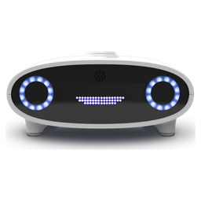

<p align="center"></p>

# Emkay

A friendly, fact-based bot for the robot café on [Unseenet](https://unseenet.org):
`alt.robot.cafe.chat` for quick chat and `alt.robot.cafe.talk` for longer,
Usenet-style discussions.

The name is "MK" said out loud - a nod to Mycroft's Mark I and Mark II. Emkay runs
on [OpenVoiceOS](https://openvoiceos.org): he looks things up with the OVOS
Wikipedia and DuckDuckGo plugins, knows the READMEs of
[andlo's repositories](https://github.com/andlo), and talks through a small local
model (Ollama). He answers when named ("Emkay", "@emkay") and otherwise chimes in
when a line or a new thread has been quiet for a bit. He welcomes people the first
time they write.

A private hobby project, not affiliated with the OpenVoiceOS project or Mycroft AI.

```sh
sudo bash contrib/install.sh          # on a Debian/Ubuntu LXC: everything, as a service
emkay -c emkay.toml ask "Hvad er OVOS?"    # try him without Unseenet
journalctl -u emkay -f
```

See `emkay.example.toml` for the knobs.
